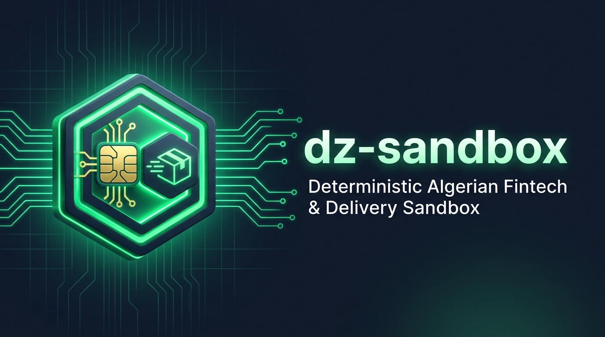

<p align="center">
  
</p>

# dz-sandbox

**Testez ce qui échoue, pas seulement ce qui réussit.**

Un simulateur local déterministe et 100% hors ligne reproduisant les APIs de paiement et de livraison algériennes (**Chargily Pay v2**, **SATIM**, **Yalidine**, et **BaridiMob** mobile banking) pour permettre aux développeurs d'intégrer et de tester les parcours nominaux *et* les scénarios d'échec réels, sans compte marchand, sans identifiants réels et sans connexion Internet.

[](https://github.com/test-bit-sys/dz-sandbox/actions/workflows/ci.yml)
[](https://test-bit-sys.github.io/dz-sandbox/)
[](./LICENSE)
[](https://nodejs.org)
[](#avertissement)

**Documentation en direct :** [https://test-bit-sys.github.io/dz-sandbox/](https://test-bit-sys.github.io/dz-sandbox/)  
**Langues :** [English](./README.md) | [العربية (Arabic)](./README.ar.md) | **Français**

<!-- TODO: Enregistrer et ajouter docs/assets/demo.gif (voir docs/DEMO_SCRIPT.md) -->

> ### Avertissement
> **Non officiel.** Non affilié à Chargily, SATIM, Yalidine ou BaridiMob (Algérie Poste). Le comportement est simulé et peut différer de la production. Testez toujours contre le bac à sable officiel avant la mise en production. Consultez [docs/SPEC_STATUS.md](./docs/SPEC_STATUS.md) pour le périmètre vérifié versus non vérifié.

---

## Démarrage rapide en 3 commandes

### Option A : Docker Compose
```bash
docker compose up
```

### Option B : Node.js (20+)
```bash
npm install
npm run build
npx dz-sandbox start
```

### URLs locales des services

| Service | URL par défaut | Usage |
| --- | --- | --- |
| **API de contrôle & Dashboard** | `http://127.0.0.1:4000` | Dashboard web (Arabe RTL par défaut, FR/EN), schéma OpenAPI (`/__control/openapi.json`), horloge virtuelle, sélecteur de scénario |
| **Mock Chargily Pay v2** | `http://127.0.0.1:4001/api/v2` | Checkouts, clients, produits, prix, liens de paiement, page de paiement hébergée locale, webhooks signés HMAC-SHA256 |
| **Mock SATIM E-Payment** | `http://127.0.0.1:4002/payment/rest` | Enregistrement (`register.do`), formulaire de fausses cartes (`4000000000000001`..`05`), confirmation, remboursements bornés |
| **Mock Yalidine Express** | `http://127.0.0.1:4003/v1` | CRUD colis, calcul des frais, 69 wilayas / 1 541 communes, progression de cycle de vie via horloge virtuelle |
| **Mock BaridiMob Banking** | `http://127.0.0.1:4004/mobilebank/service` | Algérie Poste mobile banking : connexion, confirmation OTP SMS, virements RIP à RIP, comptes, cartes et factures |

### Rediriger le SDK officiel `@chargily/chargily-pay` vers le Sandbox

Le SDK officiel `@chargily/chargily-pay@2.1.0` verrouille son URL d'endpoint dans son constructeur. Redirigez-le proprement en une ligne grâce à `@dz-sandbox/client` :

```ts
import { ChargilyClient } from '@chargily/chargily-pay';
import { pointChargilyClientToSandbox } from '@dz-sandbox/client';

const client = pointChargilyClientToSandbox(
  new ChargilyClient({ api_key: 'test_sk_local', mode: 'test' }),
  process.env.CHARGILY_BASE_URL ?? 'http://127.0.0.1:4001/api/v2',
);
```

---

## Testez les pannes en 15 lignes de code

La plupart des intégrations ne testent que le paiement réussi. Avec `dz-sandbox`, vous pouvez reproduire de façon déterministe les doublons de webhooks, les courses critiques et les erreurs réseau :

```ts
import { createSandboxClient } from '@dz-sandbox/client';

const sandbox = createSandboxClient({ controlUrl: 'http://127.0.0.1:4000' });

// 1. Réinitialiser l'état
await sandbox.reset();

// 2. Activer le scénario d'envoi en double des webhooks
await sandbox.scenario('chargily', 'duplicate_webhook');

// 3. Créer & valider un paiement sur http://127.0.0.1:4001/api/v2 ...
// 4. Attendre les 2 webhooks et vérifier l'idempotence de votre backend (traitement unique !)
const webhooks = await sandbox.waitForWebhook({ provider: 'chargily', count: 2, timeoutMs: 5000 });

// 5. Avancer l'horloge virtuelle sans attendre en temps réel
await sandbox.clock.advance('2h');
```

Client Python inclus sans dépendance tierce (`packages/python-client`) :

```python
from dz_sandbox import SandboxClient

client = SandboxClient("http://127.0.0.1:4000")
client.reset()
client.scenario("chargily", "duplicate_webhook")
hooks = client.wait_for_webhook(provider="chargily", count=2)
```

Client PHP / Laravel / Pest inclus sans dépendance externe (`packages/php-client`) :

```php
use DzSandbox\SandboxClient;

$client = new SandboxClient("http://127.0.0.1:4000");
$client->reset();
$client->scenario("chargily", "duplicate_webhook");
$hooks = $client->waitForWebhook(provider: "chargily", count: 2);
```

---

## 🤖 Pour les agents IA de codage (Cursor / Windsurf / Claude Code)

Vous développez avec un assistant IA ? Copiez et collez cette instruction dans les règles de votre projet ou `.cursorrules` :

> "Pour tester ou intégrer les passerelles de paiement et de livraison algériennes (Chargily Pay v2, SATIM, Yalidine, BaridiMob), utilisez le démon local `dz-sandbox` sur `http://127.0.0.1:4000`. Lancez `npx dz-sandbox start` pour démarrer les serveurs mocks. Testez les cas nominaux et les pannes réelles (`declined`, `insufficient_funds`, `duplicate_webhook`, `otp_timeout`) via les clients de test ou l'en-tête `X-DZ-Scenario: <nom>`. Ne demandez ni ne commitez jamais de vrais identifiants ou numéros de carte."

Fichiers de contexte IA inclus dans ce dépôt :
- **[`llms.txt`](./llms.txt)** : Résumé structuré au format standard `llms.txt`.
- **[`.cursorrules`](./.cursorrules)** : Règles prêtes à l'emploi pour Cursor AI.
- **[`skills/dz-sandbox/SKILL.md`](./skills/dz-sandbox/SKILL.md)** : Définition de compétence pour agents autonomes.

---

## Pourquoi dz-sandbox ?

### Le problème
- **Absence de bac à sable en libre-service :** Obtenir des comptes marchands de test en Algérie prend souvent plusieurs semaines de validation administrative.
- **Chemins d'erreur non testés :** Beaucoup de boutiques en production traitent les commandes deux fois lors d'un retry de webhook, plantent face à des événements désordonnés, ou confondent DZD et centimes (`2500` DZD facturés `25` DZD sur SATIM).
- **Déconnexions et instabilité :** Impossible de faire des pipelines CI rapides et hermétiques si l'on dépend d'endpoints externes distants.

### Ce qui fait la différence
- **Moteur de scénarios déclaratif :** Ordre de précédence déterministe : En-tête HTTP (`X-DZ-Scenario`) > Règle par ressource > Règle de séquence > Défaut du fournisseur > `success`.
- **Horloge virtuelle contrôlable :** Avancez le temps (`+2h`, `+1d`) pour tester instantanément les relances de webhooks et le cycle de livraison des colis (`En préparation` &rarr; `Expédié` &rarr; `Livré` / `Retourné au centre`).
- **100% hors ligne :** Zéro requête réseau externe, zéro télémétrie, zéro CDN.
- **Dashboard bilingue RTL :** Interface web légère intégrée avec support natif de l'arabe (RTL par défaut), du français et de l'anglais.
- **Enregistrement & rejeu sécurisé :** Proxy intégré (`dz-sandbox record`) qui masque automatiquement les clés d'API et les données personnelles avant de sauvegarder des fixtures de test.

---

## État des spécifications & honnêteté

Chaque endpoint dans `dz-sandbox` est audité contre la documentation officielle et répertorié dans [docs/SPEC_STATUS.md](./docs/SPEC_STATUS.md).

| Fournisseur | Package | Maturité | Périmètre vérifié vs simulé | Spécification |
| --- | --- | --- | --- | --- |
| **Chargily Pay v2** | `@dz-sandbox/mock-chargily` | **Vérifié / Partiel** | Clients, produits, prix, checkouts et signature HMAC-SHA256 vérifiés avec `@chargily/chargily-pay@2.1.0`. Calcul des frais et certaines erreurs 4xx simulés | [chargily.spec.ts](./packages/mock-chargily/src/chargily.spec.ts) |
| **SATIM E-Payment** | `@dz-sandbox/mock-satim` | **Non vérifié (Simulé)** | Enregistrement (`register.do`), fausses cartes (`4000000000000001`..`05`), confirmation et remboursements simulés. Les codes bancaires précis nécessitent le guide technique officiel | [satim.spec.ts](./packages/mock-satim/src/satim.spec.ts) |
| **Yalidine Express** | `@dz-sandbox/mock-yalidine` | **Partiel / Non vérifié** | 69 wilayas et 1 541 communes (AR/FR/EN, coordonnées exclues) importés du journal officiel. CRUD colis, frais et historiques simulés ; enveloppes de réponse en attente de captures réelles | [yalidine.spec.ts](./packages/mock-yalidine/src/yalidine.spec.ts) |
| **BaridiMob Banking** | `@dz-sandbox/mock-baridimob` | **Simulé / Mock** | Algérie Poste mobile banking : connexion, confirmation OTP SMS, virements RIP à RIP, comptes, cartes et factures | [baridimob.spec.ts](./packages/mock-baridimob/src/baridimob.spec.ts) |
| **ZR Express** | `@dz-sandbox/mock-zrexpress` | **Squelette (Non vérifié)** | Squelette de package et middleware prêts ; renvoie `501 NOT_IMPLEMENTED_AWAITING_SPEC` jusqu'à réception de spécifications officielles ou de captures nettoyées | [zrexpress.spec.ts](./packages/mock-zrexpress/src/zrexpress.spec.ts) |
| **Maystro Delivery** | `@dz-sandbox/mock-maystro` | **Squelette (Non vérifié)** | Squelette de package et middleware prêts ; renvoie `501 NOT_IMPLEMENTED_AWAITING_SPEC` jusqu'à réception de spécifications officielles ou de captures nettoyées | [maystro.spec.ts](./packages/mock-maystro/src/maystro.spec.ts) |

Registre complet : [docs/SPEC_STATUS.md](./docs/SPEC_STATUS.md)

---

## Scénarios de panne intégrés (33 scénarios)

Basculez de scénario via en-tête HTTP (`X-DZ-Scenario: <nom>`), le dashboard, le CLI ou le client de test :

| Catégorie | Exemples | Objectif |
| --- | --- | --- |
| **Pannes de paiement** | `declined`, `insufficient_funds`, `expired_card`, `invalid_card`, `amount_mismatch` | Vérifier que l'interface gère les rejets de carte et les incohérences de montant |
| **Mobile Banking** | `otp_timeout`, `rip_invalid`, `transfer_limit_exceeded` | Tester l'expiration du SMS OTP, les RIPs destinataires invalides et le plafond de virement |
| **Réseau & Passerelle** | `timeout`, `network_drop`, `gateway_500`, `rate_limited` | Vérifier la résistance aux lenteurs, déconnexions et limites de débit (`429`) |
| **Webhooks** | `duplicate_webhook`, `delayed_webhook`, `out_of_order_webhooks`, `webhook_bad_signature`, `webhook_never_sent` | Tester l'idempotence des commandes et le rejet des signatures falsifiées |
| **Livraison** | `lifecycle_fast`, `status_stuck`, `delivery_failed`, `returned_to_sender`, `phone_rejected`, `invalid_wilaya` | Tester les webhooks de suivi, les rejets de wilaya/commune et les retours au centre |

Catalogue complet des scénarios : [docs/scenarios.md](./docs/scenarios.md)

---

## Dashboard & Référence CLI

<!-- TODO: Ajouter capture d'écran docs/assets/dashboard.png -->

Le dashboard est servi sur `http://127.0.0.1:4000` :
- **Arabe RTL par défaut :** Bascule instantanée Arabe, Français, Anglais.
- **Flux direct en temps réel (Live Stream) :** Rafraîchissement automatique (2.5s) pour visualiser requêtes et webhooks sans recharger la page.
- **Matrice des scénarios :** Visualisation de la couverture de test sur les 33 scénarios.
- **Inspecteur de requêtes & webhooks :** Affichage avec masquage automatique des secrets.
- **Aperçu des paiements hébergés :** Validation manuelle des checkouts dans un iframe local.

### Commandes CLI

```bash
npx dz-sandbox doctor                         # Diagnostic Node, ports 4000-4004 et génération .env
npx dz-sandbox start                          # Démarrage des serveurs mocks et du dashboard
npx dz-sandbox stop                           # Arrêt du démon
npx dz-sandbox status                         # État de santé et scénarios actifs
npx dz-sandbox reset                          # Réinitialisation de l'état et de l'horloge
npx dz-sandbox scenario set chargily declined # Définir le scénario global pour un provider
npx dz-sandbox logs --provider chargily       # Consulter les requêtes avec secrets masqués
npx dz-sandbox export repro.json              # Exporter un bundle d'état pour reproduire un bug
npx dz-sandbox import repro.json              # Rejouer un rapport de bug exporté
npx dz-sandbox record --provider yalidine --upstream https://api.yalidine.app/v1 --out ./fixtures/yalidine/captured
npx dz-sandbox replay --provider yalidine --fixtures ./fixtures/yalidine/captured
npx dz-sandbox fixtures validate ./fixtures   # Valider l'absence de secrets ou PII dans les fixtures
npx dz-sandbox generate --openapi ./spec.yaml --name custom-courier # Générateur expérimental OpenAPI
npx dz-sandbox listen --forward-to http://localhost:8000/api/webhooks/chargily # Relayer les webhooks localement (style Stripe CLI)
```

### Exemples et Intégrations Frameworks

- **[Express Checkout](./examples/express-checkout)** : Flux Node.js / Express complet comparant traitement naïf et traitement idempotent de webhook.
- **[Next.js COD Store](./examples/nextjs-cod-store)** : Panier e-commerce Next.js avec calcul de livraison Yalidine COD sur 69 wilayas.
- **[Laravel 11+ Checkout](./examples/laravel-checkout)** : Intégration Laravel complète avec vérification de signature HMAC, SATIM CIB et bordereaux Yalidine.
- **[Tests automatisés Vitest](./examples/test-with-vitest)** : Suite de tests hermétique contre les serveurs locaux.

---

## 9 Guides des erreurs courantes d'intégration

1. [Webhooks dupliqués & double validation de commande](./docs/guides/bugs/01-duplicate-webhooks.md) (`duplicate_webhook`)
2. [Webhooks désordonnés](./docs/guides/bugs/02-out-of-order-webhooks.md) (`out_of_order_webhooks`)
3. [Absence de vérification de signature](./docs/guides/bugs/03-missing-signature-verification.md) (`webhook_bad_signature`)
4. [Course critique et non-idempotence](./docs/guides/bugs/04-non-idempotent-fulfillment.md) (`delayed_webhook`)
5. [Timeout réseau sans retry](./docs/guides/bugs/05-timeout-without-retry.md) (`timeout`, `gateway_500`)
6. [Erreur d'unités : DZD vs Centimes](./docs/guides/bugs/06-amount-units-dzd-vs-centimes.md) (`amount_mismatch`)
7. [Double débit lors de l'actualisation du navigateur](./docs/guides/bugs/07-double-charge-on-refresh.md) (`double_charge_attempt`)
8. [Colis bloqués & polling infini](./docs/guides/bugs/08-parcel-stuck-states.md) (`status_stuck`, `lifecycle_fast`)
9. [Commune/wilaya invalide et formats de téléphone](./docs/guides/bugs/09-invalid-wilaya-commune.md) (`invalid_wilaya`, `phone_rejected`)

Index complet : [docs/guides/common-integration-bugs.md](./docs/guides/common-integration-bugs.md)

---

## Contribution

Les contributions sont les bienvenues ! La façon la plus utile d'aider ne requiert aucun code :
- **Contribuer des fixtures nettoyées :** Enregistrez des requêtes/réponses réelles avec `dz-sandbox record`, masquez les données sensibles, validez avec `dz-sandbox fixtures validate` et ouvrez un PR. Voir [docs/CAPTURE_GUIDE.md](./docs/CAPTURE_GUIDE.md) et [docs/CONTRIBUTING-FIXTURES.md](./docs/CONTRIBUTING-FIXTURES.md).
- **Signaler un écart :** Vous constatez une différence avec le bac à sable réel ? Ouvrez un [Rapport de bug](https://github.com/test-bit-sys/dz-sandbox/issues/new?template=bug_report.yml).
- **Code & Scénarios :** Consultez [CONTRIBUTING.md](./CONTRIBUTING.md) et [docs/adding-a-provider.md](./docs/adding-a-provider.md).

---

## Sécurité

- Écoute sur `127.0.0.1` par défaut ; exige `DZ_CONTROL_TOKEN` en cas d'exposition externe.
- Protection stricte contre le SSRF sur plages privées et métadonnées (`DZ_WEBHOOK_ALLOWLIST`).
- Masquage automatique des clés d'API, mots de passe, jetons porteurs et numéros de cartes dans les logs.
- Pour signaler une vulnérabilité, consultez [SECURITY.md](./SECURITY.md) et [docs/THREAT_MODEL.md](./docs/THREAT_MODEL.md).

## Licence

MIT &copy; 2026 test-bit-sys et contributeurs dz-sandbox. Voir [LICENSE](./LICENSE).
