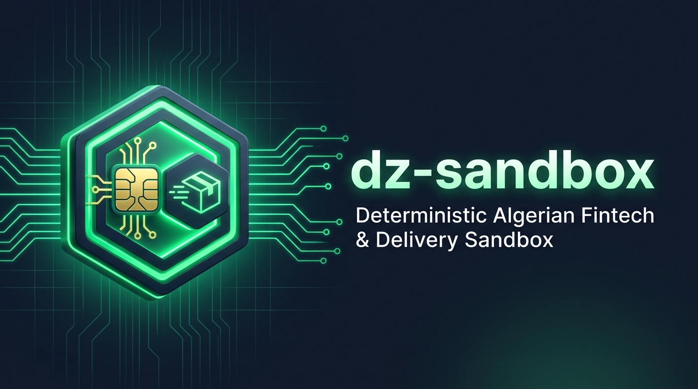

<p align="center">
  
</p>

# dz-sandbox

**Test what fails, not just what succeeds.**

A deterministic, 100% offline-first local sandbox that simulates Algerian payment and delivery APIs (**Chargily Pay v2**, **SATIM**, and **Yalidine**) so developers can integrate and test happy paths *and* real-world failure modes locally without merchant accounts, live credentials, or internet access.

[](https://github.com/test-bit-sys/dz-sandbox/actions/workflows/ci.yml)
[](./LICENSE)
[](https://nodejs.org)
[](#disclaimer)

**Languages:** English | [العربية (Arabic)](./README.ar.md) | [Français (French)](./README.fr.md)

<!-- TODO: Record and add docs/assets/demo.gif (see docs/DEMO_SCRIPT.md) -->

> ### Disclaimer
> **Unofficial.** Not affiliated with Chargily, SATIM, or Yalidine. Behavior is simulated and may differ from production. Always test against each provider's real sandbox before going live. See [docs/SPEC_STATUS.md](./docs/SPEC_STATUS.md) for verified versus unverified scope.

---

## Quick Start in 3 Commands

### Option A: Docker Compose
```bash
docker compose up
```

### Option B: Node.js (20+)
```bash
npm install
npm run build
npx dz-sandbox start
```

### Local Service Base URLs

| Service | Default URL | Purpose |
| --- | --- | --- |
| **Control API & Dashboard** | `http://127.0.0.1:4000` | Web dashboard (Arabic RTL default, FR/EN), OpenAPI schema (`/__control/openapi.json`), virtual clock, scenario switcher |
| **Chargily Pay v2 Mock** | `http://127.0.0.1:4001/api/v2` | Checkouts, customers, products, prices, payment links, local hosted payment page, HMAC-SHA256 signed webhooks |
| **SATIM E-Payment Mock** | `http://127.0.0.1:4002/payment/rest` | Registration (`register.do`), hosted fake-card form (`4000000000000001`..`05`), confirmation, bounded refunds |
| **Yalidine Express Mock** | `http://127.0.0.1:4003/v1` | Parcels CRUD, delivery fee calculation, 69 wilayas / 1,541 communes, virtual-clock lifecycle progression |

### Point the Official `@chargily/chargily-pay` SDK to the Sandbox

The official `@chargily/chargily-pay@2.1.0` SDK locks its endpoint URL in the constructor. Redirect it cleanly with one line using `@dz-sandbox/client`:

```ts
import { ChargilyClient } from '@chargily/chargily-pay';
import { pointChargilyClientToSandbox } from '@dz-sandbox/client';

const client = pointChargilyClientToSandbox(
  new ChargilyClient({ api_key: 'test_sk_local', mode: 'test' }),
  process.env.CHARGILY_BASE_URL ?? 'http://127.0.0.1:4001/api/v2',
);
```

---

## Test What Fails in 15 Lines

Most integrations only test when payments succeed. With `dz-sandbox`, you can deterministically reproduce race conditions, duplicate callbacks, and network partitions:

```ts
import { createSandboxClient } from '@dz-sandbox/client';

const sandbox = createSandboxClient({ controlUrl: 'http://127.0.0.1:4000' });

// 1. Reset state to a clean baseline
await sandbox.reset();

// 2. Set the global scenario to deliver duplicate webhooks
await sandbox.scenario('chargily', 'duplicate_webhook');

// 3. Create & complete a checkout against http://127.0.0.1:4001/api/v2 ...
// 4. Await both webhooks and verify your backend handler is idempotent (processes order once!)
const webhooks = await sandbox.waitForWebhook({ provider: 'chargily', count: 2, timeoutMs: 5000 });

// 5. Instantly trigger time-dependent lifecycle events without waiting in real time
await sandbox.clock.advance('2h');
```

Prefer Python? A zero-dependency stdlib client is included (`packages/python-client`):

```python
from dz_sandbox import SandboxClient

client = SandboxClient("http://127.0.0.1:4000")
client.reset()
client.scenario("chargily", "duplicate_webhook")
hooks = client.wait_for_webhook(provider="chargily", count=2)
```

---

## Why dz-sandbox?

### The Problem
- **No self-serve sandboxes:** Getting test merchant accounts for Algerian payment gateways or delivery APIs often takes weeks of administrative review.
- **Untested failure paths:** Production e-commerce stores frequently ship with naive webhook handlers that double-fulfill orders on retries, crash on out-of-order events, or miscalculate DZD vs. centimes (`2500` DZD charged as `25` DZD on SATIM).
- **Flaky internet in local dev:** Offline development and fast, hermetic CI pipelines are impossible when dependent on external test sandboxes.

### What Makes It Different
- **Declarative Scenario Engine:** Deterministic rule precedence: Request Header (`X-DZ-Scenario`) > Per-Resource Rule > Sequence Rule > Provider Default > `success`.
- **Controllable Virtual Clock:** Advance time (`+2h`, `+1d`) to instantly test webhook retries and multi-day parcel delivery lifecycles (`En préparation` &rarr; `Expédié` &rarr; `Livré` / `Retourné au centre`).
- **100% Offline & Hermetic:** Runs completely offline with zero external network requests, zero telemetry, and zero CDN dependencies.
- **Bilingual RTL Dashboard:** Embedded zero-dependency web interface with native Arabic (RTL default), French, and English interfaces.
- **Safe Record & Replay:** Built-in proxy (`dz-sandbox record`) that sanitizes API keys and customer PII before saving reproducible test fixtures.

---

## Provider Support & Maturity Ledger

Every endpoint in `dz-sandbox` is audited against official references and tracked in [docs/SPEC_STATUS.md](./docs/SPEC_STATUS.md). We never invent unverified behavior without marking it clearly.

| Provider | Package | Maturity | Verified vs. Simulated Scope | Configuration |
| --- | --- | --- | --- | --- |
| **Chargily Pay v2** | `@dz-sandbox/mock-chargily` | **Verified / Partial** | Customer, product, price, and checkout lifecycles and HMAC-SHA256 `signature` verified against `@chargily/chargily-pay@2.1.0`. Fee calculation and edge 4xx payloads simulated | [chargily.spec.ts](./packages/mock-chargily/src/chargily.spec.ts) |
| **SATIM E-Payment** | `@dz-sandbox/mock-satim` | **Unverified (Simulated)** | SmartVista registration (`register.do`), hosted test cards (`4000000000000001`..`05`), confirmation, and bounded refunds simulated. Exact bank-specific paths and error codes require the official bank technical PDF | [satim.spec.ts](./packages/mock-satim/src/satim.spec.ts) |
| **Yalidine Express** | `@dz-sandbox/mock-yalidine` | **Partial / Unverified** | All 69 wilayas and 1,541 communes (AR/FR/EN, coordinates excluded) imported from official administrative gazettes. Parcel CRUD, fees, and histories simulated; response envelopes await live captures | [yalidine.spec.ts](./packages/mock-yalidine/src/yalidine.spec.ts) |
| **ZR Express** | `@dz-sandbox/mock-zrexpress` | **Scaffold (Unverified)** | Package skeleton and scenario middleware wired; returns `501 NOT_IMPLEMENTED_AWAITING_SPEC` until official specs or sanitized captures are added | [zrexpress.spec.ts](./packages/mock-zrexpress/src/zrexpress.spec.ts) |
| **Maystro Delivery** | `@dz-sandbox/mock-maystro` | **Scaffold (Unverified)** | Package skeleton and scenario middleware wired; returns `501 NOT_IMPLEMENTED_AWAITING_SPEC` until official specs or sanitized captures are added | [maystro.spec.ts](./packages/mock-maystro/src/maystro.spec.ts) |

Full honesty ledger: [docs/SPEC_STATUS.md](./docs/SPEC_STATUS.md)

---

## Built-in Failure Scenarios (27 Scenarios)

Switch scenarios instantly via header (`X-DZ-Scenario: <name>`), Dashboard, CLI, or test client:

| Category | Examples | Purpose |
| --- | --- | --- |
| **Payment Failures** | `declined`, `insufficient_funds`, `expired_card`, `invalid_card`, `amount_mismatch` | Verify checkout UI handles card declines and currency/amount mismatches gracefully |
| **Network & Gateway** | `timeout`, `network_drop`, `gateway_500`, `rate_limited` | Ensure your HTTP clients implement backoff, circuit-breaking, and rate-limit (`429`) handling |
| **Webhook Delivery** | `duplicate_webhook`, `delayed_webhook`, `out_of_order_webhooks`, `webhook_bad_signature`, `webhook_never_sent` | Test idempotent order fulfillment and cryptographic signature rejection |
| **Delivery Lifecycles** | `lifecycle_fast`, `status_stuck`, `delivery_failed`, `returned_to_sender`, `phone_rejected`, `invalid_wilaya` | Test tracking webhooks, commune validation errors, and multi-day parcel returns |

Complete scenario catalog: [docs/scenarios.md](./docs/scenarios.md)

---

## Dashboard & CLI Reference

<!-- TODO: Add dashboard screenshot docs/assets/dashboard.png -->

The dashboard is served by the control plane at `http://127.0.0.1:4000`:
- **Native Arabic RTL Default:** Full bilingual Arabic, French, and English toggle.
- **Scenario Matrix:** View live test coverage across all 27 scenarios per provider.
- **Live Request & Webhook Inspector:** Inspect HTTP headers and bodies with automatic secret redaction.
- **Hosted Payment Previews:** Complete test checkouts directly in an embedded iframe.

### CLI Commands

```bash
npx dz-sandbox doctor                         # Diagnose Node, ports 4000-4003, and output .env
npx dz-sandbox start                          # Start local mock servers and web dashboard
npx dz-sandbox stop                           # Stop running sandbox daemon
npx dz-sandbox status                         # Check health and active scenarios
npx dz-sandbox reset                          # Reset store, logs, and virtual clock
npx dz-sandbox scenario set chargily declined # Set global scenario for a provider
npx dz-sandbox logs --provider chargily       # Inspect redacted request log
npx dz-sandbox export repro.json              # Export deterministic state bundle for bug reports
npx dz-sandbox import repro.json              # Replay exported state bundle locally
npx dz-sandbox record --provider yalidine --upstream https://api.yalidine.app/v1 --out ./fixtures/yalidine/captured
npx dz-sandbox replay --provider yalidine --fixtures ./fixtures/yalidine/captured
npx dz-sandbox fixtures validate ./fixtures   # Assert zero unredacted secrets or PII in fixtures
npx dz-sandbox generate --openapi ./spec.yaml --name custom-courier # Experimental OpenAPI mock generator
npx dz-sandbox listen --forward-to http://localhost:8000/api/webhooks/chargily # Forward webhooks locally (Stripe-CLI style)
```

### Examples & Framework Integrations

- **[Express Checkout](./examples/express-checkout)**: Minimal Node.js / Express checkout flow demonstrating naive vs. idempotent webhook handling.
- **[Next.js COD Store](./examples/nextjs-cod-store)**: Next.js App Router e-commerce cart with Yalidine Cash-on-Delivery (COD) shipping calculator.
- **[Laravel 11+ Checkout](./examples/laravel-checkout)**: Full Laravel integration with HMAC signature verification, SATIM CIB payment, and Yalidine parcel creation.
- **[Vitest Integration Tests](./examples/test-with-vitest)**: Automated test suite against hermetic local mock servers.

---

## Common Integration Bug Guides

Real-world guides documenting bugs commonly found in Algerian payment and courier implementations, paired with exact reproducing scenarios:

1. [Duplicate Webhooks & Double Fulfillment](./docs/guides/bugs/01-duplicate-webhooks.md) (`duplicate_webhook`)
2. [Out-of-Order Webhooks](./docs/guides/bugs/02-out-of-order-webhooks.md) (`out_of_order_webhooks`)
3. [Missing Webhook Signature Verification](./docs/guides/bugs/03-missing-signature-verification.md) (`webhook_bad_signature`)
4. [Non-Idempotent Fulfillment Race Conditions](./docs/guides/bugs/04-non-idempotent-fulfillment.md) (`delayed_webhook`)
5. [Network Timeouts Without Retry](./docs/guides/bugs/05-timeout-without-retry.md) (`timeout`, `gateway_500`)
6. [Amount Units: DZD vs. Centimes Mixups](./docs/guides/bugs/06-amount-units-dzd-vs-centimes.md) (`amount_mismatch`)
7. [Double Charges on Browser Refresh / Back Button](./docs/guides/bugs/07-double-charge-on-refresh.md) (`double_charge_attempt`)
8. [Parcel Stuck States & Polling Deadlocks](./docs/guides/bugs/08-parcel-stuck-states.md) (`status_stuck`, `lifecycle_fast`)
9. [Invalid Wilaya / Commune Names & Phone Formats](./docs/guides/bugs/09-invalid-wilaya-commune.md) (`invalid_wilaya`, `phone_rejected`)

Full guide index: [docs/guides/common-integration-bugs.md](./docs/guides/common-integration-bugs.md)

---

## Contributing

We welcome contributions! The most valuable way to contribute does not even require writing TypeScript:

- **Contribute Sanitized Fixtures:** Record real sandbox HTTP exchanges using `dz-sandbox record`, sanitize them, run `dz-sandbox fixtures validate`, and submit a PR. See [docs/CAPTURE_GUIDE.md](./docs/CAPTURE_GUIDE.md) and [docs/CONTRIBUTING-FIXTURES.md](./docs/CONTRIBUTING-FIXTURES.md).
- **Report Inconsistencies:** Found a difference between `dz-sandbox` and live sandbox behavior? Open a [Bug Report](https://github.com/test-bit-sys/dz-sandbox/issues/new?template=bug_report.yml).
- **Code & Scenarios:** See [CONTRIBUTING.md](./CONTRIBUTING.md) and [docs/adding-a-provider.md](./docs/adding-a-provider.md).

---

## Security

- Binds to `127.0.0.1` by default; requires explicit `DZ_CONTROL_TOKEN` when exposed on external interfaces.
- Blocks private-range and metadata SSRF on outbound webhooks (`DZ_WEBHOOK_ALLOWLIST`).
- Automatically redacts API keys, passwords, bearer tokens, and payment card numbers from logs.
- For vulnerability disclosure instructions, see [SECURITY.md](./SECURITY.md) and [docs/THREAT_MODEL.md](./docs/THREAT_MODEL.md).

## License

MIT &copy; 2026 test-bit-sys and dz-sandbox contributors. See [LICENSE](./LICENSE).
